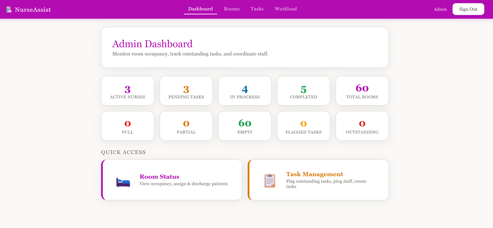

# NurseAssist

A hospital care coordination app. Patients submit requests from their rooms, nurses claim and complete tasks from a shared pool, and administrators manage rooms, monitor staff workload, and flag urgent work.

Built for Full-Stack Web Development (ICSI 418Y) at the University at Albany, SUNY.



## Features

**Administrators**
- Dashboard overview of rooms, tasks and staff
- Room management with two beds per room
- Create, edit and flag tasks, and ping the assigned nurse about urgent ones
- Real-time staff workload view, calculated with MongoDB aggregation

**Nurses**
- Shared task pool: accept, decline or complete tasks
- Personal dashboard showing their own assigned work

**Patients**
- Submit care requests directly from their room

**Everyone**
- Role-based login that sends each user to the views for their role

## Tech stack

| Part | Technology |
|------|------------|
| Frontend | React 18, React Router |
| Backend | Node.js, Express (REST API) |
| Database | MongoDB Atlas |

## API overview

| Route group | Purpose |
|-------------|---------|
| `/api/rooms` | Rooms and bed assignments |
| `/api/tasks` | Creating, updating, flagging and pinging tasks |
| `/api/nurses` | Nurse records and the task pool |
| `/api/admin` | Admin views, including workload aggregation |

## Running it locally

You need Node.js and a MongoDB database (a free MongoDB Atlas cluster works).

1. Copy each `.env.example` file to a file named `.env` in the same folder, and fill in your MongoDB connection string.
2. Start the server:
   ```
   cd server
   npm install
   node seed.js
   node index.js
   ```
   `node seed.js` fills the database with sample rooms, nurses, patients and tasks. You only need to run it once.
3. In a second terminal, start the website:
   ```
   cd client
   npm install
   npm start
   ```
   If it asks to use a different port, accept.

### Demo logins

| Role | Username | Password |
|------|----------|----------|
| Admin | `admin` | `admin123` |
| Nurse | `Dylan`, `chinwe`, `vince`, `chelsea` or `adreis` | `nurse123` |
| Patient | `patient1` to `patient5` | `pass123` |

## Known limitations and next steps

This was built as a course project, so some production features are missing:

- **Authentication:** the logged-in session lives only in the browser's memory (refreshing logs you out), and access is controlled only by which pages the frontend shows, with no server-side checks. Next step: JWT authentication with server-side checks on every route.
- **Notifications:** pings are recorded, but nurses aren't notified in real time.
- **Patient privacy:** patients should only see their own room's tasks, and rooms should be locked to the patient assigned to them.

## Team

Developed primarily by **Dylan Walker** and **Chinwe Ofonagoro**.

### My contributions (Dylan Walker)

- Built the Express REST API (rooms, tasks, nurses and admin routes) and its MongoDB Atlas integration
- Built the admin section: dashboard, room management, task management and the workload view
- Built the nurse task pool, nurse dashboard, patient request view and role-based login routing
- Created a shared CSS design system used across the app


